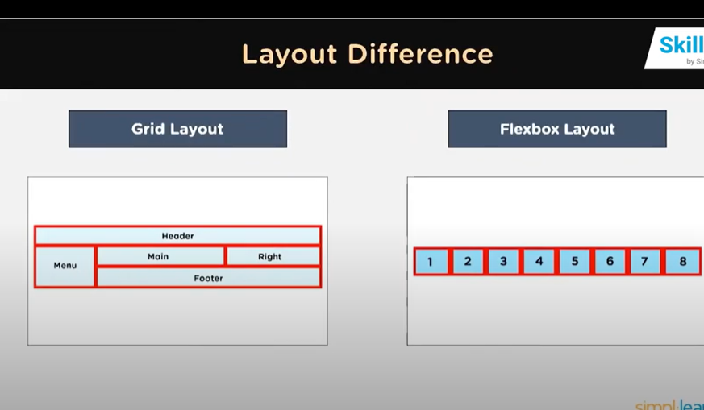

Grid vs Flexbox:
what is a Grid Layout?
*The CSS Grid Layout is a two-dimensional grid-based layout system,
with rows and columns
*It is a useful in creating more complex and organized layouts.
*To define a grid container, you will have to pass a **display:grid** property to your element.

what is a CSS Flexbox?
*The CSS Flexbox is a one-dimensional layout. It is useful in allocating and aligning the space among items in a grid container.
*Flex layout makes it easier to design and build responsive web pages without using a lot of float and position properties in our CSS code.
*To start using Flexbox, you must create a flex container using the **display:flex** property.

