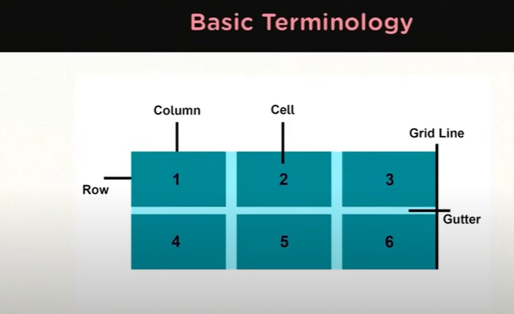

What's in it for you?
*CSS Grid Layout
*Features of CSS Grid Layout
*Basic Terminology
*Hands-on-Demo

What is a Grid?
A grid is a set of intersecting horizontal and vertical lines defining columns and rows. Elements can be placed onto the grid within these column and row lines.

What is a CSS Grid Layout?
CSS Grid Layout introduces a two-dimensional grid system to CSS. Grids can be used to lay out major page areas or small user interface elements.

Features of CSS Grid Layout:
*Fixed and flexible track size
*Item placement
*Creation of additional tracks to hold content
*Control of overlapping content

Basic Terminology:

*Grid Lines are the vertical and horizontal lines that divide the grid and separate the columns and rows.
*Grid column is the vertical track of a grid.
*Grid row is the horizontal track of the grid.
*Grid cell is a single unit of CSS grid.
*Gutter is the space between rows and columns in a grid.